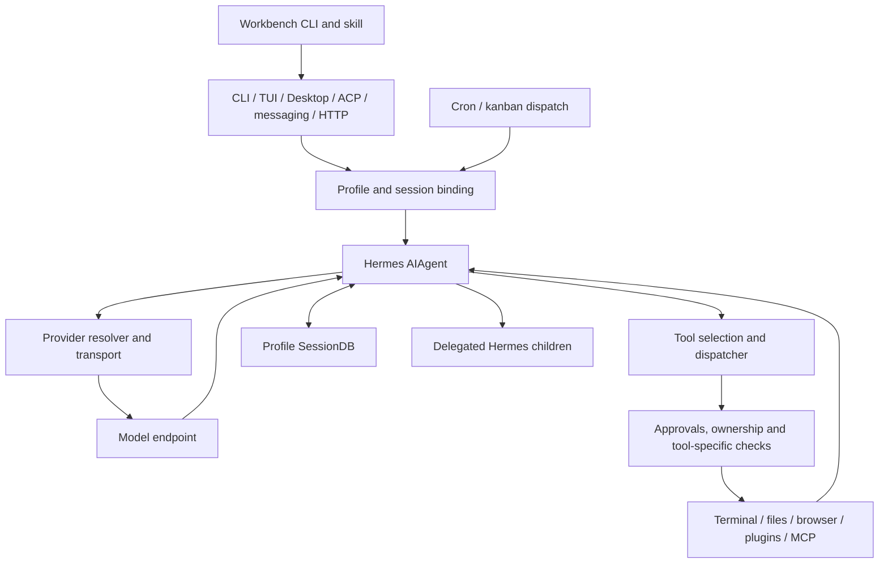

# Hermes Agent: source, tools and extension map

This is a source map for integrating Agent Workbench into Hermes while keeping
Hermes's own agent loop, tools and session controls. The useful integration seam
is the native Hermes CLI plus a portable skill package. Hermes already provides
delegation, goals, durable conversation storage, scheduling and kanban; Workbench
adds an explicit workflow shared with other clients and portable handoff records.

The companion [machine inventory](hermes-agent-2026-09-25.inventory.json) indexes
every tracked Python module in the runtime areas below, its public top-level
symbols, imports, source digest, tool declarations and plugin manifests. It is a
navigation aid, not a claim that every function has been behaviorally audited.

## Snapshot and evidence boundary

| Source | Exact pin | Meaning |
| --- | --- | --- |
| Fresh official clone | `59004a62356f3a4697ab0fe8ad5086d2b405e2a6` | Primary reference for this guide; tracked worktree was clean when inspected. |
| Previously installed source | `190e1ffac976ee5fc41c9f1845ba8fd886a827b1` | Comparison baseline; package declaration `0.17.0`; tracked worktree clean. |
| Fresh package declaration | `0.0.0` | Unstamped checkout placeholder, **not** a useful installed release number. Source declares release date `2026.9.24`; installed version resolution uses installer metadata. |

All upstream links below pin the fresh commit. These are observations of local
copies of the official repository, including its documentation. No private
configuration, account information, auth stores, transcripts, model reasoning or
environment values were loaded to generate the inventory. No Hermes module was
imported, prerequisite checker executed, or model/tool service called by this
source survey. Runtime installation and live integration checks are separate
work; the clone alone does not establish which runtime a shell launches.

Coverage is 1,915 runtime Python modules, 60 registration sites, 61 toolset
declarations, 95 unique tool names mentioned by those toolsets, 104 plugin
manifests, 58 bundled skills and 150 optional skills. The tool counts are different
units: a loop can register many tools, a generic MCP registrar can register names
unknown until connection, and a bundle includes tools from several toolsets.
Tests, vendored dependencies, skill scripts and operational scripts are outside
the Python module index. Frontend packages are mapped at their architectural
boundaries rather than function by function.

Sources: [upstream snapshot][snapshot], [version declaration][pyproject],
[version resolution][version], [architecture guide][architecture].

## What runs, and where the boundaries are



The sequence for a normal native turn is:

1. Bootstrap applies the selected profile before modules that consult home or
   configuration are imported. The frontend resolves the workspace, session and
   provider, and constructs `AIAgent` with callbacks appropriate to that surface.
2. Agent initialization assembles instructions, project context, memory, tools,
   transport and compression state. These prompt components have caching and
   session-boundary rules; changing a file need not change an in-flight prompt.
3. The conversation loop performs preflight and compression checks, constructs a
   provider request, consumes streamed or complete output, normalizes tool calls,
   and executes eligible tools. Tool output becomes model context for the next
   iteration. Provider errors, interruptions, empty responses and context limits
   have distinct recovery paths.
4. The owning frontend projects progress, handles human requests, and persists
   messages and usage. A completed process, a completed agent turn, a delivered
   event and a verified task outcome remain different facts.

The main entry is still `run_agent.AIAgent`, but the fresh source decomposes it
into sibling modules and mixins. Old diagrams showing a single enormous
`run_agent.py` or `cli.py` miss much of today's implementation. Follow the facade
to its defining module; temporary compatibility exports are not stable internal
extension APIs. [Agent facade][agent], [conversation loop][loop],
[agent contributor map][agent-map], [root contributor map][root-map].

### Two meanings of “Codex inside Hermes”

| Route | Who owns the agent loop and tools? | Relevant code |
| --- | --- | --- |
| `codex_responses` | Hermes owns the loop; the remote endpoint supplies model responses. Hermes tool calls, delegation and sessions remain native. | `agent/codex_runtime.py`, `agent/codex_responses_adapter.py`, `agent/transports/codex.py` |
| `codex_app_server` | A `codex app-server` subprocess owns its native turn; Hermes bridges events, history and optionally Hermes tools. | `agent/transports/codex_app_server*.py`, `agent/transports/hermes_tools_mcp_server.py` |

App-server mode is an explicit runtime choice, gated to supported OpenAI provider
routes. It is not required merely to authenticate with a ChatGPT subscription.
The requested Hermes exploration/integration uses the first architectural route.
The label `codex_responses` also serves some other Responses-compatible providers;
its name alone does not prove the endpoint or billing arrangement.
[Runtime resolver][runtime-provider], [Codex runtime branches][codex-runtime].

## Runtime subsystem map

The counts here are Python modules, excluding tests. For each individual module,
search `modules[].path` in the JSON inventory to see its synopsis, public symbols
and line numbers. The table groups the major implementation families.

| Area | Modules | Responsibility and important submodules |
| --- | ---: | --- |
| Root | 49 | `hermes_bootstrap` and `hermes_constants` establish home/runtime paths; `run_agent` and `cli` expose the agent and interactive CLI; `model_tools` selects and dispatches tools; `toolsets` defines bundles; `hermes_state` plus `hermes_state_*` owns persistence; `mcp_serve` exposes Hermes as MCP; `batch_runner` and `mini_swe_runner` are batch/evaluation entrypoints; `trajectory_compressor` handles offline trajectories; logging, time and YAML helpers support these. |
| `agent/` | 308 | Model orchestration, prompt construction, context management, provider wires and lifecycle. Families include `agent_init`, `conversation_*`, `turn_*`, `api_*`, `chat_completion_*`, `anthropic_*`, `codex_*`, `transports/`, `auxiliary_*`, `credential_*`, `fallback_*`, `context_*`, `prompt_*`, `reasoning_*`, `tool_*`, `memory_*`, `skill_*`, `secret_sources/`, `vault_backends/`, `lsp/`, `monitoring/`, relay and usage accounting. |
| `hermes_cli/` | 601 | Frontend and management control plane: parser/main/subcommands, CLI mixins, single-query/stream output, profile/config/model/auth resolution, sessions/goals, skills and plugin management, MCP onboarding, setup/doctor, update/local runtime, web server/router/dashboard auth, kanban CLI, proxy/egress commands, observability and service installation. |
| `tools/` | 337 | Model-facing schemas and handlers, registry/discovery, approval machinery, terminal environments and process ownership, file safety, browser/desktop bridges, MCP connection/search/dispatch, delegation, code execution, skill/memory/session tools, media, search, connectors and channel-specific actions. |
| `gateway/` | 174 | Long-running inbound/outbound routing. `run*` orchestrates lifecycle; `session*` handles identity/history/recovery; `profile_routing` and profile reconciliation serve multiple profiles; `authz`/pairing authorize senders; `platforms/` supplies adapters and API server; queueing, stream, delivery, relay, hooks and shutdown modules maintain session ownership. |
| `tui_gateway/` | 98 | Shared JSON-RPC backend for terminal/desktop clients: entry/loop/server, session lifecycle, prompt dispatch and event projection, `methods/` and `contracts/`, model/config/connector/project operations, open human requests, process/delegation control, hosted/compute and transport handling. |
| `acp_adapter/` | 14 | Async editor protocol around synchronous Hermes: entry/server, session manager, auth resolver, event bridge, permission bridge, tool rendering, commands/content and model catalog. |
| `cron/` | 33 | Schedules, atomic job storage, due-occurrence dispatch, execution records, delivery, retries, profile ticker ownership, inactivity watchdogs and script execution. It launches separate Hermes runs or explicitly configured script jobs. |
| `plugins/` | 239 | Bundled extension implementations and registration: model providers, platforms, memory, web search, image/video generation, browser, dashboard auth, cron/context providers, observability and application plugins such as kanban, Spotify and meeting workflows. Presence on disk is not activation. |
| `providers/` | 2 | Small provider abstraction/registry entry layer; most concrete provider code lives in `plugins/model-providers/` and the agent's transport/resolution modules. |
| `hermes_platform/` | 12 | Central platform facts, runtime/tool resolver and capability declarations. Control host, terminal execution target and GUI client may be different machines. |
| `pm/` | 48 | Managed packages/environments, artifact provenance, receipts, locks, downloads, installation/launch/recovery and plugin dependency preparation. Use this abstraction when extending Hermes packaging rather than adding independent installers. |

Additional products and supporting areas:

- `ui-tui/` implements the Ink terminal UI. It renders state received from the
  Python `tui_gateway`; the UI does not independently implement tool execution.
- `apps/desktop/` contains Electron and the React desktop application, with
  shared types/components under `apps/shared/`. Desktop plugins add supported UI
  contributions. Desktop capabilities are negotiated per session.
- `web/` contains the browser dashboard, including the terminal embedding path.
  Its HTTP server/control APIs live largely in `hermes_cli/web_*`. A browser
  terminal wrapping a PTY and the native desktop RPC client are distinct paths.
- `skills/` and `optional-skills/` are task instructions and supporting assets;
  they are not automatically new tool registry entries. `plugin-catalog/` and
  other catalogs describe installable extensions, not proof of local execution.
- `scripts/`, tests, benchmark/evaluation material, deployment assets and
  `website/` support development and operations. The inventory intentionally does
  not present these as the enabled agent runtime.

Sources: [architecture][architecture], [TUI gateway map][tui-map],
[desktop map][desktop-map], [platform layer][platform], [package manager][pm].

## Provider configuration and reasoning depth

Provider resolution is separate from transport normalization. A provider profile
can declare aliases, auth mode, endpoints, model catalog behavior and its wire
format. Runtime resolution handles explicit overrides, configured providers,
custom provider entries, credential pools and fallback policy. The main turn and
auxiliary tasks such as compression, titles, approval review, memory review and
delegation can select different routes. A successful main model request therefore
does not validate all side-model routes.

The source supports OpenAI-style chat completions, Responses/Codex, native
Anthropic, Bedrock and provider-specific adapters, with native Gemini/Vertex paths
in the surrounding provider integration. The pluggable transport registry is the
normalization seam; do not infer that every provider implements every feature.
[Provider extension contract][provider-plugin], [runtime resolver][runtime-provider],
[transport registry][transports], [model configuration][model-config].

`agent.reasoning_effort` and `--reasoning` choose reasoning depth, independently
of final answer verbosity. The canonical ladder is `none`, `minimal`, `low`,
`medium`, `high`, `xhigh`, `max`, `ultra`. The fresh implementation clamps to the
nearest supported level for the route; `ultra` is an internal requested tier,
not a valid provider wire value. For the source's Astra model family on the Codex
route, supported wire levels are `low`, `medium`, `high`, `xhigh`, `max`, so
`ultra` sends `max`. Other routes can top out lower. Explicit provider capability
metadata can refine these decisions.

There is no automatic “ultra spawns a team” behavior in this effort normalizer.
Delegation, goals and Mixture of Agents are separate orchestration mechanisms.
Likewise, `agent.text_verbosity` controls answer length on supported Responses
routes and is not a reasoning budget. Main-model effort does not automatically
set all auxiliary models' effort; same-model background review intentionally
inherits parent settings for prompt-cache consistency.
[Canonical effort implementation][effort], [reasoning settings][config].

For short-lived credentials, `key_cmd` is a first-class provider surface. Hermes
executes the trusted configured command in the served profile's environment,
accepts a bare token or token JSON with supported expiry fields, and caches it
until refresh time. Explicit one-off API key overrides have precedence. The
helper uses a shell and therefore is executable operator configuration, not
untrusted prompt data. Error messages intentionally omit command/stdout/stderr
because those can contain credentials. This enables a broker that asks the
official auth owner for current credentials without copying refresh-token stores
into a Hermes profile. That design still needs runtime validation; source support
is not proof of account authorization or endpoint readiness.
[Command token source][key-cmd], [Codex provider profile][codex-provider].

## Tool selection: five different states

1. **Declared:** a toolset, schema or plugin mentions the tool.
2. **Registered:** discovery imported its module/plugin or connected its server
   and added a registry entry in the current process.
3. **Selected:** this session's platform toolsets, explicit choices, exclusions
   and capabilities admit it.
4. **Prerequisites pass:** the applicable `check_fn` accepts local dependencies,
   provider configuration, platform/worker role and other requirements.
5. **Works:** an actual invocation succeeds with current credentials, network,
   permissions, service state and arguments.

These do not collapse into one “installed tools” count. `requires_env` declarations
are useful onboarding metadata but do not enumerate every prerequisite. Browser
providers, terminal backends and MCP servers can discover capabilities dynamically.
Some checks may inspect Docker, SDKs or services, so this survey did not run them.
Every catalog entry in the JSON explicitly leaves session selection/readiness
unobserved or unprobed.

`model_tools` performs discovery, toolset expansion/filtering and dynamic schema
adjustment, then dispatches admitted calls. Some agent-owned tools are handled
inline. Large dynamic catalogs can be exposed through tool search/description/call
bridges rather than every schema in the initial prompt. The bridge must retain
the session's allowed tool boundary; registration alone is not admission.
[Tool dispatcher][model-tools], [registry][registry], [tool runtime guide][tool-runtime].

### Complete declared tool families at this pin

This table lists all 95 distinct names in `toolsets.py`. It does not include
arbitrary MCP/plugin names discovered later. Names such as `process_manage` are
the fresh source names; old documentation may still say `process`.

| Family / toolset | Model-facing names | Dependencies and contextual gates |
| --- | --- | --- |
| Web/search | `web_search`, `web_extract`, `x_search` | Selected search/extraction provider and its SDK/service/auth; X search has its own provider requirements. `search` is an alias/bundle, not an extra tool. |
| Terminal | `terminal`, `process_manage` | Resolved terminal backend, workspace/environment availability; approvals and process ownership. Local is one backend; remote/container backends require their own runtime. |
| Files | `read_file`, `write_file`, `patch`, `search_files` | Workspace/terminal backend access, path handling, read tracking and write guards. Command execution remains a separate surface. |
| Skills | `skills_list`, `skill_view`, `skill_manage` | Selected skills roots, platform/prerequisite visibility, write approval where configured. A skill can require further CLI or service setup. |
| Browser navigation | `browser_navigate`, `browser_snapshot`, `browser_click`, `browser_type`, `browser_scroll`, `browser_back`, `browser_press`, `browser_get_images`, `browser_vision`, `browser_console`, `browser_cdp`, `browser_dialog`, `browser_exec` | Browser provider/extension/runtime; action-specific routing and availability; vision adds a model route. These are not guaranteed by a browser package merely being present. |
| Browser vault | `browser_vault_list`, `browser_vault_unlock`, `browser_vault_fill`, `browser_vault_save_login`, `browser_vault_enter_code` | Vault backend, browser connection and human unlock/capture workflows; secrets stay in the native facility. |
| Media | `vision_analyze`, `video_analyze`, `image_generate`, `video_generate`, `xai_video_edit`, `xai_video_extend`, `text_to_speech` | Selected media providers, model support, codecs/runtime packages and service auth. xAI editing/extension is specifically gated to that video provider. |
| Session assistance | `todo_list`, `memory`, `session_search`, `clarify` | Agent/session-owned stores or human response surface. `clarify` usefulness depends on the frontend's ability to return a response. |
| Composition | `execute_code`, `delegate_task` | Code execution environment/tool bridge; child provider route and delegation capacity. These do not authorize toolsets excluded from the parent. |
| Scheduling | `cronjob_manage` | Native scheduler storage and configured delivery context; creating a schedule is an effect, not simply adding a todo. |
| Connections/setup/project | `manage_connections`, `manage_catalog`, `desktop_project` | Native connection/catalog UI bridges; setup role for catalog management; project-capable desktop session for project operations. |
| Desktop UI | `desktop_preview`, `annotate_preview`, `read_window_below`, `read_terminal`, `close_terminal`, `focus_pane`, `show_tip`, `gui_tour`, `drive_preview`, `react_to_message` | Ten per-session renderer capabilities; their declaration does not mean a CLI-only session supplies the necessary UI bridge. |
| Computer interaction | `computer_use` | Selected computer-use implementation and control target; platform permissions/service readiness. |
| Discord | `discord`, `discord_admin` | Bot permissions and configured action filters; core participation and server administration are distinct toolsets. |
| Yuanbao | `yb_query_group_info`, `yb_query_group_members`, `yb_search_sticker`, `yb_send_dm`, `yb_send_sticker` | Yuanbao platform context/provider and corresponding capability checks. |
| Feishu | `feishu_doc_read`, `feishu_drive_list_comments`, `feishu_drive_list_comment_replies`, `feishu_drive_reply_comment`, `feishu_drive_add_comment` | Feishu application configuration/scopes and resource permissions. |
| Home Assistant | `ha_list_entities`, `ha_get_state`, `ha_list_services`, `ha_call_service` | Home Assistant connection and client/runtime availability. Calling a service is an external effect. |
| Kanban | `kanban_show`, `kanban_list`, `kanban_complete`, `kanban_block`, `kanban_request_review`, `kanban_request_changes`, `kanban_heartbeat`, `kanban_comment`, `kanban_create`, `kanban_link`, `kanban_unblock`, `kanban_attach`, `kanban_attach_url`, `kanban_attachments` | Board/worker mode and task ownership; orchestrator-only operations are hidden from task workers. Attachments and review state are durable board data. |
| Spotify | `spotify_playback`, `spotify_devices`, `spotify_queue`, `spotify_search`, `spotify_playlists`, `spotify_albums`, `spotify_library` | Enabled Spotify plugin and its account/client prerequisites. |

The source of truth for exact grouping is [toolsets.py][toolsets]. The catalog
links each name to a literal registration or a specific table-driven registration
site, with checker and declared environment-variable **names**, never values.
Provider-specific dependencies live in the cited handler, plugin manifest and
`pyproject.toml`; the inventory records core requirements and optional extras.

The default core bundle has 59 declared tools, but that is not a promise that 59
schemas will appear in every session. `coding`, `safe`, `hermes-cli`, `hermes-acp`,
`hermes-cron` and channel-specific bundles include different sets. `safe` names a
tool subset; it is not an OS sandbox. ACP's coding-oriented bundle removes the
normal clarification tool in favor of its host interaction model. Webhook has a
narrow default set. Desktop UI and project tools depend on session capabilities,
not a process-global desktop flag. [Toolset definitions][toolsets],
[tool contributor map][tools-map].

## Session state, memory, skills and context

`SessionDB` is a facade over the `hermes_state_*` modules and a profile-local
SQLite database. It stores sessions, messages, usage, routing and related durable
records; WAL and search indexes support concurrent use and recall. The fresh
compression design keeps the current session identity stable and archives prior
message generations rather than treating identical text as duplicate history.
Native-runtime transcript mirroring has separate ownership rules. Importing
these internal rows directly into Workbench would couple it to schema/lifecycle
details that its portable handoff deliberately avoids.
[Session storage guide][session-storage], [database facade][state].

Four different “memory” mechanisms matter:

- The `memory` tool maintains compact durable agent/user notes which are injected
  into future context according to native write and session-boundary policies.
- Conversation recall uses stored sessions and `session_search`; it is not the
  same store as those compact notes.
- Memory providers implement a pluggable lifecycle for external/contextual
  memory. Presence under `plugins/memory/` does not select or authenticate one.
- Background review/skill curation can derive useful notes or reusable skills.
  These have independent model routes, write controls and budgets. Do not export
  their private transcripts as portable workflow evidence.

Skills are Markdown instruction packages with frontmatter, optional scripts and
assets. Listing/viewing skills and invoking an external tool are separate actions.
Hermes supports task skill discovery, preloading, creation/management, optional
skill catalogs and plugin-provided skills. Project instruction discovery includes
Hermes instructions and familiar project files; the child-agent context path
reuses project rules without implicitly copying the parent's entire conversation.
New skill/tool/memory content normally joins a later session to preserve prompt
cache stability; explicit reload/`--now` behavior is a deliberate exception.
[Memory guide][memory-guide], [skill guide][skills-guide],
[memory-provider contract][memory-plugin], [context engine][context-engine].

Profiles scope config, state, skills, secrets and runtime ownership. In a
multiplexed gateway the served profile is context-bound; it may differ from the
process's launch environment. Callback/thread/subprocess propagation is therefore
part of correctness, not cosmetic path selection. Hermes has several config
readers for CLI, gateway and management surfaces; editing a new environment flag
does not guarantee all three consume it. Prefer supported profile and provider
configuration. [Profiles][profiles], [multiplex design][multiplex],
[secret scope][secret-scope], [bootstrap][bootstrap].

## Native orchestration and interruption

`delegate_task` creates child Hermes agents with their own conversation and
terminal ownership. It passes explicit goal/context and project instructions,
then returns summaries; it does not copy the full parent chat by default. Children
inherit allowed toolsets, with role/depth restrictions and configurable alternate
model routes. The current source defaults to ten concurrent children and a flat
depth limit of one; finite single-query sessions also have a separate total child
cap. Child delegation capability is derived from depth and the orchestrator
enable switch: the legacy `role` argument is accepted but ignored in the fresh
implementation. See the source before using the older documentation's role
examples. [Delegation facade][delegate], [delegation config][delegate-config].

Top-level delegation can return a background handle when the owning surface can
deliver later results. Orchestrator children and stateless surfaces use waiting
paths as needed. Steering queues guidance at iteration/tool boundaries; an
acknowledgment means queued, not necessarily consumed. Results retain missed or
pending steering when completion wins the race. Stop/cancel follows the owned
spawn tree and preserves interrupted partial results. Child background processes
are cleaned up on teardown unless an explicit supported process handoff transfers
ownership; returning a PID alone does not transfer it.

Completed delegation events are persisted before delivery. After a crash, a
finished-but-undelivered completion can be replayed, but a child still running at
the crash becomes `unknown`: Hermes does not claim its effects did not occur or
restart it automatically. Delivery acknowledgment also does not prove a later
model turn or outbound message succeeded. Structured child output validation can
fail while the task still retains its raw completed summary; check
`schema_valid`, not only `status`. [Delegation lifecycle][delegation-guide].

Other orchestration layers solve different problems:

- `hermes_cli/goals.py` and frontend goal commands maintain an objective and
  continuation/judgment state around turns, including background-work awareness.
- Mixture of Agents runs configured reference models as advisers, then gives
  their output to an aggregator that owns the actual Hermes tool request. It can
  repeat at model iterations; it is not equivalent to delegated workers making
  independent tool calls. Per-slot models/effort and cadence are explicit settings.
- Cron creates scheduled runs with its own profile/session and delivery route.
  Jobs can specify skills, models, working directories or explicit script mode.
  The fresh scheduler records occurrence/execution state, uses profile-scoped
  ownership and an inactivity watchdog, and handles deliveries separately. Do
  not confuse a watchdog with a fixed maximum duration of all active work.
- Kanban persists dependency/review/task ownership in a board store and dispatches
  claimed worker runs. Board/task fences, worker identities, heartbeats and
  process identity checks prevent unrelated sessions from treating a card as
  theirs. This is already a durable native workflow facility.

Sources: [goals][goals], [Mixture of Agents][moa], [cron internals][cron-guide],
[cron contributor map][cron-map], [kanban tools][kanban].

## Plugins, MCP and other customization seams

| Need | Preferred surface | Boundary to preserve |
| --- | --- | --- |
| Reusable instructions or an existing CLI workflow | Skill with supporting scripts | Tool availability and command permissions remain native; instructions do not grant privileges. |
| Share Workbench instructions across supported clients | Root `plugin.json` using portable Agent Plugins v1 plus `skills/` | Hermes has a real portable adapter. A Codex/Claude-specific manifest alone is not the same format. |
| New native tool/hook/command/provider behavior | Hermes `plugin.yaml` plus `register(ctx)` | Plugin activation, capability consent and namespacing; plugin Python is trusted local code, not sandboxed by its manifest. |
| Existing remote/local tool ecosystem | Configured MCP server | Per-server admission, credentials, process environment, tool selection and reconnect/reload semantics. |
| New inference route | Model provider plugin/custom provider plus transport where needed | Auth owner, wire format, supported model/effort metadata and side-model routes. |
| New execution environment | Terminal environment plugin | Target filesystem/process ownership, lifecycle and approval/container boundaries. |
| Specialized memory/context/search/media/platform | Corresponding provider/plugin interface | Select the provider explicitly; installability is not readiness. |
| Custom human approval presentation | Approval transport plugin | Select the transport separately; failure defaults to denial unless an explicit fallback is configured. |
| User-facing panels, palette/status contributions | Desktop plugin SDK | Session capabilities and frontend transport contracts. |
| Lifecycle automation | Native plugin hooks or configured shell hooks | These are executable callbacks with separate activation/consent and output handling. |

Native general plugins, model-provider plugins and memory-provider plugins have
different discovery rules. General plugins are principally opt-in with documented
selected-provider/backend exceptions. Model providers allow supported override
discovery; memory providers have their own shadowing rules. Project-local plugin
discovery is a trust choice. Catalog installation includes pinned provenance and
installer metadata; this is not a reason to import arbitrary plugin code merely
to list it. [Plugin contracts][plugins-guide], [plugin contributor map][plugins-map],
[portable adapter][portable], [desktop plugin SDK][desktop-sdk].

MCP has two directions. Hermes is a **client** of configured stdio/HTTP servers,
discovering and registering their tools. Hermes also has a **server** mode that
exposes selected Hermes functionality over stdio. These are different entrypoints
and trust boundaries. Large catalog search is a prompt optimization, not automatic
admission of every connected tool. Changes to schemas can invalidate prompt
caches; reload is a session operation with its own behavior. MCP subprocess
environments are filtered/profile-aware; a plugin's MCP access has its own
default-off, per-server permission surface. [MCP guide][mcp-guide],
[tool runtime][tool-runtime], [MCP server entry][mcp-serve].

Dependency surfaces are similarly layered: `pyproject.toml` declares core and
optional Python groups; managed runtime/package code prepares supported binaries
and environments; plugin manifests declare extension requirements; provider/tool
checks establish the next availability gate. Installing all extras is neither
necessary nor proof that every remote service is usable. Optional groups include
MCP/ACP, messaging platforms, web/search providers, media/voice, computer use,
container/cloud terminals, memory backends and observability. The JSON retains
the precise declarations instead of turning them into an installation recipe.

## Approvals, credentials and execution safety

The command guard facade separates pattern detection, non-overridable floors,
profile/session approval state, smart review, manual prompts and frontend bridges.
Hardline blocks and configured deny rules run before ordinary approval shortcuts.
Approval modes and headless policies are real configuration; a wrapper should
preserve them instead of injecting blanket approvals. Command pattern policy is
not an OS capability sandbox. Filesystem mounts, credentials and networking still
matter when selecting a container or remote terminal backend.

At this pin, initial `HERMES_YOLO_MODE` is frozen at import and explicit session
state manages later changes. The prose security guide's claim that the variable
is reread before every command is stale. More relevant to Workbench, top-level
`hermes -z` deliberately sets both YOLO and hook-acceptance flags. Use the native
`hermes chat` single-query path when the integration promises to retain native
permission controls. Do not equate the top-level convenience command with the
similarly named exit-after-query option.
[Approval implementation][approval], [top-level oneshot][oneshot],
[security guide][security].

Other controls include file write guards, project/context scanning, channel user
authorization and pairing, MCP environment filtering, scoped secret/vault
providers, and optional egress facilities. Outbound egress credential injection
and inbound subscription/proxy servers are distinct systems. Their presence in
the repository does not show either is active on this machine. Native session
logs and delegation transcripts can contain tool arguments, private task data and
reasoning snippets; they are deliberately outside this report and portable
handoff artifacts. [File guards][file-guards], [secret source interface][secret-plugin],
[egress design][egress], [gateway internals][gateway-guide].

## Programmatic interfaces and the Workbench contract

The smallest complete process interface at this pin is conceptually:

```text
hermes --profile PROFILE chat --query-file - --format stream-json --reasoning ultra
```

The caller writes the prompt to stdin and starts in the intended workspace.
`--query-file` also accepts a file path, validates empty/conflicting input and
avoids embedding the prompt in the process argument list. It is not itself an
auth or permission override. Resume uses Hermes's supported session argument;
retain the returned native session ID rather than pretending the Workbench run
ID is the Hermes session ID. [Parser][parser], [CLI entry][cli-main].

Stream JSON emits initialization, text, tool-use/tool-result and terminal result
records. The result includes `session_id`, `exit_code`, final text, token counts
and elapsed duration, with optional error. Tool input/output records may contain
task data and should remain private local logs. Reasoning progress is not emitted
by this format. Single-query execution distinguishes successful completion (0),
failure/incomplete completion (1) and interruption (130). The terminal record and
OS process outcome both matter; useful-looking text alone is not success.
[Stream emitter][stream-json], [single-query lifecycle][single-query].

For a richer embedded host:

- **ACP** provides editor sessions, prompt/cancel/fork/resume, events and a human
  permission bridge over stdio JSON-RPC. Stdout is protocol-only. ACP reuses
  Hermes provider/auth resolution and durable sessions; it is not a second auth
  store. Client support limits the user experience.
- **TUI gateway RPC** supports live sessions, prompt submission, steer/interrupt,
  history/config/model operations, process and subagent controls. Approval,
  clarification, secret/vault and related human interactions are server-to-client
  **requests**, not ordinary progress events. Clients negotiate support and
  handle pending/replayed requests on reconnect.
- **HTTP API server** exposes compatibility endpoints and richer run/session
  controls, including event streams, approval, steering and stop. An accepted
  steer can remain pending if the turn ends; a correct host distinguishes
  queued input from consumed guidance and each terminal run status.
- **Direct Python `AIAgent`** is available for in-process integration, but couples
  a consumer to more lifecycle, callback and internal-version detail than a CLI
  wrapper. It is unnecessary for the initial Workbench integration.

Sources: [programmatic integration contract][programmatic],
[ACP internals][acp-guide], [TUI gateway map][tui-map].

Workbench should preserve four separate identifiers/facts: its workflow/run ID,
the Hermes native session ID, the process attempt/outcome, and the operator's
evidence or review decision. Export only the portable manifest, notes, decisions,
questions, evidence references and next actions. Imported historical success is
context; executable tasks begin pending. This lets a receiving Hermes, Codex or
Claude session inspect the next step without importing another client's auth,
private transcripts or inferred permission grants.

## Differences from the previous installed snapshot

This is a migration-oriented selection, not a full release history. The inventory
contains added/removed runtime module paths between the two exact commits.

| Fresh source change | Integration implication |
| --- | --- |
| Broad decomposition into facades/sibling modules | Patch/read the defining owner; avoid depending on transitional compatibility re-exports. |
| `--query-file`, stream JSON and explicit reasoning controls in the CLI path | Native structured process integration is practical without screen scraping or a bespoke model proxy. |
| Central `reasoning_effort.py` | Request `ultra` at the Hermes interface; let route-aware code send supported `max`/lower values. |
| `command_token_source.py` | A trusted broker can supply renewable short-lived tokens without storing copied refresh credentials in Hermes. |
| Portable Agent Plugins v1 adapter | A shared root manifest and skill can integrate Workbench without patching core tool code. |
| Expanded multiplex/profile and UI-session capability handling | Avoid process-global assumptions about secrets, home paths or desktop capability. |
| `process_manage`, `todo_list`, `cronjob_manage` names in source toolsets | Use current schema names; older examples may still show former spellings. |
| Delegation lifecycle and durable completion records | Separate completion delivery from durable execution; a crashed running child is unknown, not safely retryable. |
| Child composition tools and depth-derived role | Fresh children retain programmatic tool composition where allowed; current nesting follows configured depth, not the legacy role argument. |
| Cron lifecycle and watchdog changes | Active work is not equivalent to an expired fixed wall-clock allowance; schedule/execution/delivery state must be interpreted separately. |

Known documentation drift found during this pass: `tools/AGENTS.md` has older
delegation default counts/depth; the delegation feature guide still describes
role-gated orchestration; security prose describes the old YOLO environment
read behavior; some examples retain old tool names. The corresponding fresh
implementation wins in this guide. This is why the exact source pin accompanies
the artifact rather than only a release label.

## Runtime observations from the integration session

The coordinating integration checks on 2026-09-25 selected the fresh source pin
above through the `hermes` entrypoint, using Python 3.14.3 and OpenAI SDK 2.24.0.
A native Hermes smoke query against the configured Astra subscription route
returned the requested marker and exited successfully. The isolated profile used
the Responses transport and a short-lived credential broker; the prior default
profile was preserved. These are runtime observations reported by that check,
separate from the source-only inventory method.

A second check captured an actual CLI request against a credential-free local
fixture. It confirmed `ultra` became `reasoning.effort=max`, with `store=false`
and `stream=true`. That session exposed these 18 schemas:

```text
clarify, delegate_task, execute_code, hermes_tool_search, memory, patch,
read_file, search_files, skill_view, skills_list, terminal, text_to_speech,
tool_call, tool_describe, vision_analyze, web_extract, web_search, write_file
```

The three discovery/dispatch bridge names illustrate why the 95 source-declared
names and a live schema count differ. This captured exposure does not test each
tool's functional readiness. Subsequent integration checks enabled the portable
Workbench plugin in the Astra profile and verified a native Hermes task followed
by an independent command checking its artifact. A second synthetic capture
verified that explicitly routing title generation to the named custom provider
preserves the account header; the profile now uses that route. Main-request
reasoning remains `max`; title generation is a separate request without that
reasoning field. See the [setup guide](../hermes.md) for use and boundaries.

## Using and validating the inventory

Useful fields in the JSON:

- `modules`: relative source path, SHA-256, line count, synopsis, public symbols,
  imports and explicit `static_index` coverage.
- `toolsets`: literal/resolved declared membership, includes, descriptions and
  any role/posture metadata. The extraction uses a bounded AST interpreter, not
  imports or execution of Hermes source.
- `tool_registration_sites`: actual registration-call locations, names or
  unresolved dynamic expressions, checkers and declared requirement names.
- `declared_tool_catalog`: the 95 named tools, bundles that mention them, direct
  registration or source-audited dynamic registration candidates, and separate
  unobserved/unprobed availability fields.
- `plugin_manifests` and `dependencies`: public source declarations; no private
  local plugin configuration, enabled lists or auth values.
- `module_change_index`: runtime paths added/removed since the old source pin.

Validation for this source artifact checks JSON structure/count consistency,
unique relative paths/tool names, registration/source references, public pinned
links and absence of machine-specific home/account values. It does not substitute
for Hermes tests, real dependency checks, authenticated inference, or a permission
round trip on each frontend. Those outcomes should be recorded separately with
their own observed runtime/profile and date.

[snapshot]: https://github.com/NousResearch/hermes-agent/tree/59004a62356f3a4697ab0fe8ad5086d2b405e2a6
[pyproject]: https://github.com/NousResearch/hermes-agent/blob/59004a62356f3a4697ab0fe8ad5086d2b405e2a6/pyproject.toml
[version]: https://github.com/NousResearch/hermes-agent/blob/59004a62356f3a4697ab0fe8ad5086d2b405e2a6/hermes_cli/__init__.py
[architecture]: https://github.com/NousResearch/hermes-agent/blob/59004a62356f3a4697ab0fe8ad5086d2b405e2a6/website/docs/developer-guide/architecture.md
[root-map]: https://github.com/NousResearch/hermes-agent/blob/59004a62356f3a4697ab0fe8ad5086d2b405e2a6/AGENTS.md
[agent]: https://github.com/NousResearch/hermes-agent/blob/59004a62356f3a4697ab0fe8ad5086d2b405e2a6/run_agent.py
[loop]: https://github.com/NousResearch/hermes-agent/blob/59004a62356f3a4697ab0fe8ad5086d2b405e2a6/agent/conversation_loop.py
[agent-map]: https://github.com/NousResearch/hermes-agent/blob/59004a62356f3a4697ab0fe8ad5086d2b405e2a6/agent/AGENTS.md
[runtime-provider]: https://github.com/NousResearch/hermes-agent/blob/59004a62356f3a4697ab0fe8ad5086d2b405e2a6/hermes_cli/runtime_provider.py
[codex-runtime]: https://github.com/NousResearch/hermes-agent/blob/59004a62356f3a4697ab0fe8ad5086d2b405e2a6/agent/codex_runtime.py
[tui-map]: https://github.com/NousResearch/hermes-agent/blob/59004a62356f3a4697ab0fe8ad5086d2b405e2a6/tui_gateway/AGENTS.md
[desktop-map]: https://github.com/NousResearch/hermes-agent/blob/59004a62356f3a4697ab0fe8ad5086d2b405e2a6/apps/desktop/AGENTS.md
[platform]: https://github.com/NousResearch/hermes-agent/tree/59004a62356f3a4697ab0fe8ad5086d2b405e2a6/hermes_platform
[pm]: https://github.com/NousResearch/hermes-agent/tree/59004a62356f3a4697ab0fe8ad5086d2b405e2a6/pm
[provider-plugin]: https://github.com/NousResearch/hermes-agent/blob/59004a62356f3a4697ab0fe8ad5086d2b405e2a6/website/docs/developer-guide/model-provider-plugin.md
[transports]: https://github.com/NousResearch/hermes-agent/blob/59004a62356f3a4697ab0fe8ad5086d2b405e2a6/agent/transports/__init__.py
[model-config]: https://github.com/NousResearch/hermes-agent/blob/59004a62356f3a4697ab0fe8ad5086d2b405e2a6/website/docs/user-guide/configuring-models.md
[effort]: https://github.com/NousResearch/hermes-agent/blob/59004a62356f3a4697ab0fe8ad5086d2b405e2a6/agent/reasoning_effort.py
[config]: https://github.com/NousResearch/hermes-agent/blob/59004a62356f3a4697ab0fe8ad5086d2b405e2a6/website/docs/user-guide/configuration.md
[key-cmd]: https://github.com/NousResearch/hermes-agent/blob/59004a62356f3a4697ab0fe8ad5086d2b405e2a6/agent/command_token_source.py
[codex-provider]: https://github.com/NousResearch/hermes-agent/blob/59004a62356f3a4697ab0fe8ad5086d2b405e2a6/plugins/model-providers/openai-codex/__init__.py
[model-tools]: https://github.com/NousResearch/hermes-agent/blob/59004a62356f3a4697ab0fe8ad5086d2b405e2a6/model_tools.py
[registry]: https://github.com/NousResearch/hermes-agent/blob/59004a62356f3a4697ab0fe8ad5086d2b405e2a6/tools/registry.py
[tool-runtime]: https://github.com/NousResearch/hermes-agent/blob/59004a62356f3a4697ab0fe8ad5086d2b405e2a6/website/docs/developer-guide/tools-runtime.md
[toolsets]: https://github.com/NousResearch/hermes-agent/blob/59004a62356f3a4697ab0fe8ad5086d2b405e2a6/toolsets.py
[tools-map]: https://github.com/NousResearch/hermes-agent/blob/59004a62356f3a4697ab0fe8ad5086d2b405e2a6/tools/AGENTS.md
[session-storage]: https://github.com/NousResearch/hermes-agent/blob/59004a62356f3a4697ab0fe8ad5086d2b405e2a6/website/docs/developer-guide/session-storage.md
[state]: https://github.com/NousResearch/hermes-agent/blob/59004a62356f3a4697ab0fe8ad5086d2b405e2a6/hermes_state.py
[memory-guide]: https://github.com/NousResearch/hermes-agent/blob/59004a62356f3a4697ab0fe8ad5086d2b405e2a6/website/docs/user-guide/features/memory.md
[skills-guide]: https://github.com/NousResearch/hermes-agent/blob/59004a62356f3a4697ab0fe8ad5086d2b405e2a6/website/docs/user-guide/features/skills.md
[memory-plugin]: https://github.com/NousResearch/hermes-agent/blob/59004a62356f3a4697ab0fe8ad5086d2b405e2a6/website/docs/developer-guide/memory-provider-plugin.md
[context-engine]: https://github.com/NousResearch/hermes-agent/blob/59004a62356f3a4697ab0fe8ad5086d2b405e2a6/agent/context_engine.py
[profiles]: https://github.com/NousResearch/hermes-agent/blob/59004a62356f3a4697ab0fe8ad5086d2b405e2a6/website/docs/user-guide/profiles.md
[multiplex]: https://github.com/NousResearch/hermes-agent/blob/59004a62356f3a4697ab0fe8ad5086d2b405e2a6/website/docs/developer-guide/multiplexing-gateway.md
[secret-scope]: https://github.com/NousResearch/hermes-agent/blob/59004a62356f3a4697ab0fe8ad5086d2b405e2a6/agent/secret_scope.py
[bootstrap]: https://github.com/NousResearch/hermes-agent/blob/59004a62356f3a4697ab0fe8ad5086d2b405e2a6/hermes_bootstrap.py
[delegate]: https://github.com/NousResearch/hermes-agent/blob/59004a62356f3a4697ab0fe8ad5086d2b405e2a6/tools/delegate_tool.py
[delegate-config]: https://github.com/NousResearch/hermes-agent/blob/59004a62356f3a4697ab0fe8ad5086d2b405e2a6/tools/delegate_tool_config.py
[delegation-guide]: https://github.com/NousResearch/hermes-agent/blob/59004a62356f3a4697ab0fe8ad5086d2b405e2a6/website/docs/user-guide/features/delegation.md
[goals]: https://github.com/NousResearch/hermes-agent/blob/59004a62356f3a4697ab0fe8ad5086d2b405e2a6/hermes_cli/goals.py
[moa]: https://github.com/NousResearch/hermes-agent/blob/59004a62356f3a4697ab0fe8ad5086d2b405e2a6/website/docs/user-guide/features/mixture-of-agents.md
[cron-guide]: https://github.com/NousResearch/hermes-agent/blob/59004a62356f3a4697ab0fe8ad5086d2b405e2a6/website/docs/developer-guide/cron-internals.md
[cron-map]: https://github.com/NousResearch/hermes-agent/blob/59004a62356f3a4697ab0fe8ad5086d2b405e2a6/cron/AGENTS.md
[kanban]: https://github.com/NousResearch/hermes-agent/blob/59004a62356f3a4697ab0fe8ad5086d2b405e2a6/tools/kanban_tools.py
[plugins-guide]: https://github.com/NousResearch/hermes-agent/blob/59004a62356f3a4697ab0fe8ad5086d2b405e2a6/website/docs/developer-guide/plugins/index.md
[plugins-map]: https://github.com/NousResearch/hermes-agent/blob/59004a62356f3a4697ab0fe8ad5086d2b405e2a6/plugins/AGENTS.md
[portable]: https://github.com/NousResearch/hermes-agent/blob/59004a62356f3a4697ab0fe8ad5086d2b405e2a6/hermes_cli/agent_plugins.py
[desktop-sdk]: https://github.com/NousResearch/hermes-agent/blob/59004a62356f3a4697ab0fe8ad5086d2b405e2a6/website/docs/developer-guide/desktop-plugin-sdk.md
[mcp-guide]: https://github.com/NousResearch/hermes-agent/blob/59004a62356f3a4697ab0fe8ad5086d2b405e2a6/website/docs/user-guide/features/mcp.md
[mcp-serve]: https://github.com/NousResearch/hermes-agent/blob/59004a62356f3a4697ab0fe8ad5086d2b405e2a6/mcp_serve.py
[approval]: https://github.com/NousResearch/hermes-agent/blob/59004a62356f3a4697ab0fe8ad5086d2b405e2a6/tools/approval.py
[oneshot]: https://github.com/NousResearch/hermes-agent/blob/59004a62356f3a4697ab0fe8ad5086d2b405e2a6/hermes_cli/oneshot.py
[security]: https://github.com/NousResearch/hermes-agent/blob/59004a62356f3a4697ab0fe8ad5086d2b405e2a6/website/docs/user-guide/security.md
[file-guards]: https://github.com/NousResearch/hermes-agent/blob/59004a62356f3a4697ab0fe8ad5086d2b405e2a6/tools/file_tools_write_guards.py
[secret-plugin]: https://github.com/NousResearch/hermes-agent/blob/59004a62356f3a4697ab0fe8ad5086d2b405e2a6/website/docs/developer-guide/secret-source-plugin.md
[egress]: https://github.com/NousResearch/hermes-agent/blob/59004a62356f3a4697ab0fe8ad5086d2b405e2a6/website/docs/developer-guide/egress-internals.md
[gateway-guide]: https://github.com/NousResearch/hermes-agent/blob/59004a62356f3a4697ab0fe8ad5086d2b405e2a6/website/docs/developer-guide/gateway-internals.md
[parser]: https://github.com/NousResearch/hermes-agent/blob/59004a62356f3a4697ab0fe8ad5086d2b405e2a6/hermes_cli/_parser.py
[cli-main]: https://github.com/NousResearch/hermes-agent/blob/59004a62356f3a4697ab0fe8ad5086d2b405e2a6/hermes_cli/main.py
[stream-json]: https://github.com/NousResearch/hermes-agent/blob/59004a62356f3a4697ab0fe8ad5086d2b405e2a6/hermes_cli/stream_json.py
[single-query]: https://github.com/NousResearch/hermes-agent/blob/59004a62356f3a4697ab0fe8ad5086d2b405e2a6/hermes_cli/cli_single_query.py
[programmatic]: https://github.com/NousResearch/hermes-agent/blob/59004a62356f3a4697ab0fe8ad5086d2b405e2a6/website/docs/developer-guide/programmatic-integration.md
[acp-guide]: https://github.com/NousResearch/hermes-agent/blob/59004a62356f3a4697ab0fe8ad5086d2b405e2a6/website/docs/developer-guide/acp-internals.md
